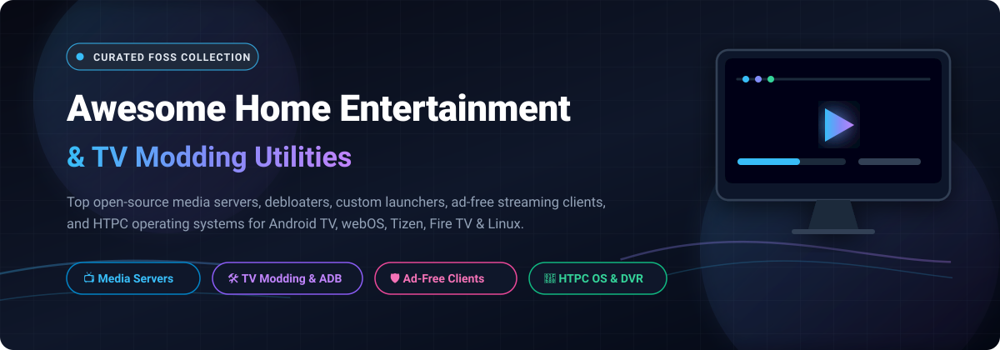

# 📺 Awesome Home Entertainment &amp; TV Modding Utilities 🚀

  <strong>Curated directory of top home entertainment media servers, Smart TV modding toolkits, custom Android TV / Fire TV launchers, ad-free streaming clients, and HTPC operating systems.</strong>

  
  
  
  
  

  🌟 Star if you like it! | 🤝 Contributions welcome | 🏷️ Android TV • Fire TV • webOS • Tizen • HTPC • FOSS

---

## 📑 Table of Contents

- [📊 Sector Overview &amp; Market Dynamics](#-sector-overview--market-dynamics)
- [💼 SaaS/Hosted Platforms](#-saashosted-platforms)
- [🌐 Open-Source Equivalents &amp; Tools](#-open-source-equivalents--tools)
  - [🖥️ Self-Hosted Media Servers](#-self-hosted-media-servers)
  - [🛠️ TV Modding, Custom Launchers &amp; ADB Utilities](#️-tv-modding-custom-launchers--adb-utilities)
  - [🛡️ Ad-Free Streaming Clients &amp; Smart TV Mods](#️-ad-free-streaming-clients--smart-tv-mods)
  - [🚀 HTPC Operating Systems &amp; Media Centers](#-htpc-operating-systems--media-centers)
  - [📡 Live TV, IPTV, DVR &amp; Media Automation](#-live-tv-iptv-dvr--media-automation)
- [⭐ Star History](#-star-history)
- [💖 Support &amp; Sponsoring](#-support--sponsoring)
- [🤝 Contributing](#-contributing)

---

## 📊 Sector Overview &amp; Market Dynamics

The global home media server and personal streaming software market is valued at approximately **$2.14B** and is projected to expand at a CAGR of ~8–12.5% as local 4K libraries, cord-cutting, and home streaming setups multiply. The industry exhibits a bifurcated structure that is **moderately fragmented**: commercial hardware/streaming is anchored by major ecosystem players like Plex and Harman/Samsung (Roon), while the enthusiast and self-hosted software layer is heavily fragmented among niche commercial utilities and privacy-focused open-source platforms (Jellyfin, Kodi).

---

## 💼 SaaS/Hosted Platforms

Commercial, freemium, and proprietary media servers, cloud sync platforms, and paid home theater applications sorted by company scale (valuation / funding / revenue).

| 🏷️ Platform | 📝 Description | 💳 Pricing (Starting Tier) | 🎁 Free Tier Limits / Free Trial | 📈 Company Scale (Valuation / Revenue / Funding) |
| :--- | :--- | :--- | :--- | :--- |
| **[Roon](https://roon.app)** | Audiophile multi-room music management and streaming ecosystem for high-end home theater setups. | $14.99/mo (or $149.88/yr billed annually) | 14-day free trial with full feature access | **$8.0B+** (Acquired by Harman International, a wholly owned subsidiary of Samsung Electronics) |
| **[Plex Media Server &amp; Plex Pass](https://plex.tv)** | Media server and cloud-authenticated streaming ecosystem with hosted discovery, live TV, and mobile apps. | $6.99/mo (or $69.99/yr) | Free forever plan with basic streaming &amp; playback; lacks hardware transcoding, mobile downloads, and live TV DVR | **$132M+ funding raised** (Valued at ~$60M–$65M estimated annual revenue, backed by Kleiner Perkins) |
| **[RapidSeedbox (Kodi Cloud / Managed Hosting)](https://rapidseedbox.com)** | Managed high-speed seedbox and remote cloud media hosting pre-configured for Kodi, Plex, and streaming automation. | $5.00/mo (Lean Basic tier: 500 GB storage, 10 Gbps port) | 14-day money-back guarantee with full plan features (no permanent free tier) | **~$5M–$10M est. revenue** (Bootstrapped private web host, 15+ employees) |
| **[PlayOn Cloud](https://playon.tv)** | Cloud-based streaming DVR allowing users to record and download streaming video for offline playback on TVs. | $4.99/mo (Cloud 100 GB plan with 30 monthly recording credits) | 7-day free trial with 5 to 7 free recording credits and 7 days of temporary cloud storage | **~$2M–$5M est. revenue** (MediaMall Technologies, Inc., 12+ employees) |
| **[Infuse Pro](https://firecore.com)** | High-performance media player for Apple TV, iOS, and macOS with Trakt/iCloud sync and direct Plex/Jellyfin streaming. | $1.99/mo (or $16.99/yr) | 7-day free trial of Pro; free forever base tier limited to basic audio/video codecs (no Dolby Vision, Atmos, or cloud streaming) | **~$1M–$5M est. revenue** (Firecore LLC, bootstrapped indie studio, 1–10 employees) |
| **[Channels DVR Server](https://getchannels.com)** | Whole-home DVR and personal media server platform integrating OTA antennas, TV Everywhere, and local libraries. | $8.00/mo (or $80.00/yr) | 30-day (1 month) free trial with full access to whole-home DVR recording &amp; guide data | **~$1M–$3M est. revenue** (Fancy Bits, LLC, bootstrapped indie team, ~3 employees) |
| **[Emby Premiere](https://emby.media)** | Personal media server offering hardware transcoding, live TV DVR, and cloud-synced multi-client streaming apps. | $4.99/mo (or $54.00/yr) | 14-day free trial of Premiere; free forever basic server tier excludes hardware transcoding, Live TV/DVR, and offline sync | **~$1M–$3M est. revenue** (Emby LLC, bootstrapped private software vendor, &lt;10 core contributors) |
| **[Mezzmo](https://conceiva.com)** | DLNA/UPnP media server for Windows designed to organize and stream movies, music, and photos to Smart TVs. | $29.95 one-time perpetual license | 15-day free trial with full transcoding and streaming capabilities; locks server access after 15 days | **&lt;$1M est. revenue** (Conceiva Pty. Ltd., boutique software development firm) |

---

## 🌐 Open-Source Equivalents &amp; Tools

Free and open-source software (FOSS) media servers, TV modding toolkits, debloaters, custom launchers, and HTPC operating systems. Each item features an official star badge linking directly to its GitHub stargazers page, sorted by star count (descending) within each category.

### 🖥️ Self-Hosted Media Servers

* **[Jellyfin](https://github.com/jellyfin/jellyfin)**  - The premier 100% free and open-source software media system with no proprietary tracking, paywalls, or central auth servers.
* **[Navidrome](https://github.com/navidrome/navidrome)**  - Fast, lightweight open-source music server and streamer compatible with Subsonic/Airsonic clients for home audio setups.
* **[Audiobookshelf](https://github.com/advplyr/audiobookshelf)**  - Self-hosted audiobook and podcast server with streaming apps and multi-user progress sync for home setups.
* **[Owncast](https://github.com/owncast/owncast)**  - Open-source, self-hosted live video streaming server for broadcasting custom channels across home devices.
* **[Dim](https://github.com/Dusk-Labs/dim)**  - Modern, self-hosted open-source media manager built in Rust focused on dark-mode aesthetics and fast metadata matching.
* **[Universal Media Server (UMS)](https://github.com/UniversalMediaServer/UniversalMediaServer)**  - Free, open-source DLNA, UPnP, and HTTP(S) Media Server capable of transcoding and streaming to almost any Smart TV.
* **[Gerbera](https://github.com/gerbera/gerbera)**  - Open-source UPnP/DLNA media server for Linux with a modern web UI for streaming local media to Smart TVs.

### 🛠️ TV Modding, Custom Launchers &amp; ADB Utilities

* **[scrcpy](https://github.com/Genymobile/scrcpy)**  - Display, control, and sideload APKs onto Android TV, Fire TV, and Nvidia Shield devices over ADB with ultra-low latency.
* **[tv-vibehack (gathin23)](https://github.com/gathin23/tv-vibehack)**  - Open-source TV modding and customization utility for unlocking, tweaking, and enhancing Smart TV functionality.
* **[RootMyTV](https://github.com/RootMyTV/RootMyTV.github.io)**  - Open-source rooting exploit toolkit for LG webOS Smart TVs executed directly through the browser.
* **[Homebrew Channel (webOS)](https://github.com/webosbrew/webos-homebrew-channel)**  - Independent open-source homebrew package manager and app repository for rooted and developer-mode LG webOS TVs.
* **[TizenBrew](https://github.com/reisxd/TizenBrew)**  - Open-source framework enabling custom mods, homebrew package injection, and ad-free apps on Samsung Tizen Smart TVs.
* **[FLauncher](https://gitlab.com/etienn01/flauncher)** - Open-source, lightweight, ad-free custom launcher for Android TV and Google TV built with Flutter to replace bloated home screens.

### 🛡️ Ad-Free Streaming Clients &amp; Smart TV Mods

* **[NewPipe](https://github.com/TeamNewPipe/NewPipe)**  - Lightweight, privacy-first open-source streaming frontend with background playback and zero proprietary Google Play dependencies.
* **[SmartTube](https://github.com/yuliskov/SmartTube)**  - Free, open-source, ad-free media player for Android TV and Fire TV supporting 4K HDR, 60fps, SponsorBlock, and casting.
* **[Nova Video Player](https://github.com/nova-video-player/aos-AVP)**  - Open-source video player designed specifically for Android TV, tablets, and phones with automatic poster scrapers and SMB/NFS support.
* **[TizenTube](https://github.com/reisxd/TizenTube)**  - Open-source TizenBrew module bringing ad-blocking and SponsorBlock to Samsung Tizen Smart TVs.
* **[Stremio Core](https://github.com/Stremio/stremio-core)**  - Modern, open-source media aggregator core engine powering TV frontends, torrent streaming, and community addons.
* **[YouTube AdFree (webOS)](https://github.com/webosbrew/youtube-webos)**  - Open-source modified YouTube client for LG webOS Smart TVs featuring ad-blocking, SponsorBlock, and background audio.

### 🚀 HTPC Operating Systems &amp; Media Centers

* **[Kodi](https://github.com/xbmc/xbmc)**  - Award-winning, open-source home theater software and media center hub designed for 10-foot living room interfaces.
* **[Bazzite](https://github.com/ublue-os/bazzite)**  - Next-generation open-source OCI living-room and HTPC operating system providing Steam Big Picture and home entertainment console experiences.
* **[LibreELEC](https://github.com/LibreELEC/LibreELEC.tv)**  - "Just enough OS" open-source Linux distribution built specifically to run Kodi smoothly on Raspberry Pi, x86 HTPCs, and ARM boxes.
* **[ChimeraOS](https://github.com/ChimeraOS/chimeraos)**  - Open-source couch-gaming and living-room HTPC operating system turning standard PCs into modern living-room media appliances.
* **[CoreELEC](https://github.com/CoreELEC/CoreELEC)**  - Lightweight, open-source "Just Enough OS" fork tailored specifically for Amlogic-based TV boxes and set-top hardware.
* **[OSMC (Open Source Media Center)](https://github.com/osmc/osmc)**  - Free, open-source, Debian-based media center OS offering full Linux package flexibility alongside a sleek Kodi interface.

### 📡 Live TV, IPTV, DVR &amp; Media Automation

* **[iptv-org/iptv](https://github.com/iptv-org/iptv)**  - Collection of publicly available IPTV channels from all over the world compatible with all Smart TV IPTV clients.
* **[Sonarr](https://github.com/Sonarr/Sonarr)**  - Smart TV and media PVR for Usenet and BitTorrent users automating episodic TV show downloads.
* **[Radarr](https://github.com/Radarr/Radarr)**  - Movie collection manager and automated downloader integrated with home media servers and Usenet/BitTorrent.
* **[Jellyseerr](https://github.com/Fallenbagel/jellyseerr)**  - Open-source media request management and discovery tool built specifically for Jellyfin, Plex, and Emby ecosystems.
* **[Prowlarr](https://github.com/Prowlarr/Prowlarr)**  - Indexer manager and proxy integration for Sonarr, Radarr, and Lidarr across home media setups.
* **[Overseerr](https://github.com/sct/overseerr)**  - Request management and media discovery tool designed for personal media servers.
* **[Bazarr](https://github.com/morpheus65535/bazarr)**  - Companion application that automatically fetches and synchronizes multi-language subtitles for Sonarr and Radarr.
* **[Tvheadend](https://github.com/tvheadend/tvheadend)**  - TV streaming server and digital video recorder for Linux supporting DVB-S/S2, DVB-C, DVB-T, ATSC, and IPTV feeds.
* **[ErsatzTV](https://github.com/ErsatzTV/ErsatzTV)**  - Software for configuring and streaming custom live linear TV channels and electronic program guides (EPG) using local media.
* **[Tunarr](https://github.com/chrisbenincasa/tunarr)**  - Modern platform to create custom live TV channels from Plex, Jellyfin, and Emby libraries with full XMLTV EPG guides.
* **[xTeVe](https://github.com/xteve-project/xTeVe)**  - Virtual M3U IPTV tuner emulator for Plex, Jellyfin, and Emby DVR functionality.
* **[Threadfin](https://github.com/Threadfin/Threadfin)**  - Active fork of xTeVe providing enhanced M3U proxy routing and electronic program guide mapping for home TV servers.

---

## 📈 Star History

---

## 💖 Support &amp; Sponsoring

Thank you for visiting and supporting **Awesome Home Entertainment &amp; TV Modding Utilities**! 🌟

If you find this curated collection helpful for upgrading your living room setup, building an HTPC, debloating Smart TVs, or managing media servers:
- ⭐ **Star this repository** to help others discover it!
- 🍴 **Fork the repo** to add your favorite tools or customize your own setups.
- 📢 **Share it** with friends, Reddit homelab communities, and home theater enthusiasts!
- ☕ **Buy a coffee &amp; sponsor ongoing development**: Support via the [GitHub Sponsor Dashboard](https://github.com/sponsors/ishandutta2007).

Every star, contribution, and sponsor is immensely appreciated! 🙏

---

## 🤝 Contributing

Contributions are welcome! Feel free to open a Pull Request to add more open-source media servers, Smart TV modding tools, custom launchers, or HTPC utilities.

1. Fork the repository.
2. Add your tool or utility under the appropriate category with a concise description and its official repository link.
3. Submit a Pull Request.
